# Mealie Kitchen Display

A touch-friendly Home Assistant panel for browsing, searching and cooking from your [Mealie](https://mealie.io/) recipes, built for a kitchen tablet. Open it from the sidebar, from a launcher card, or from a configurable dashboard card.

Everything beyond the basics is optional and uses the services you already have in Home Assistant rather than bundling its own:

- **AI recipe finder** — describe a dish and have an LLM write the recipe, or photograph a cookbook page and have it transcribed, using your own `ai_task` entities. Generated recipes are kept so you can save the keepers to Mealie later.
- **Voice input** — dictate into the search and AI prompt boxes with your own speech-to-text engine.
- **Ask for a recipe out loud** — "show me a recipe for fried chicken" puts the results on the screen you asked from, whether that's a wall tablet, a browser or the companion app on your phone.

All requests to Mealie are proxied server-side through Home Assistant, so it works regardless of whether Home Assistant or Mealie run on HTTP or HTTPS — the browser only ever talks to Home Assistant's own origin.
<p align="center">
  <a href="docs/images/01-recipe-grid.png">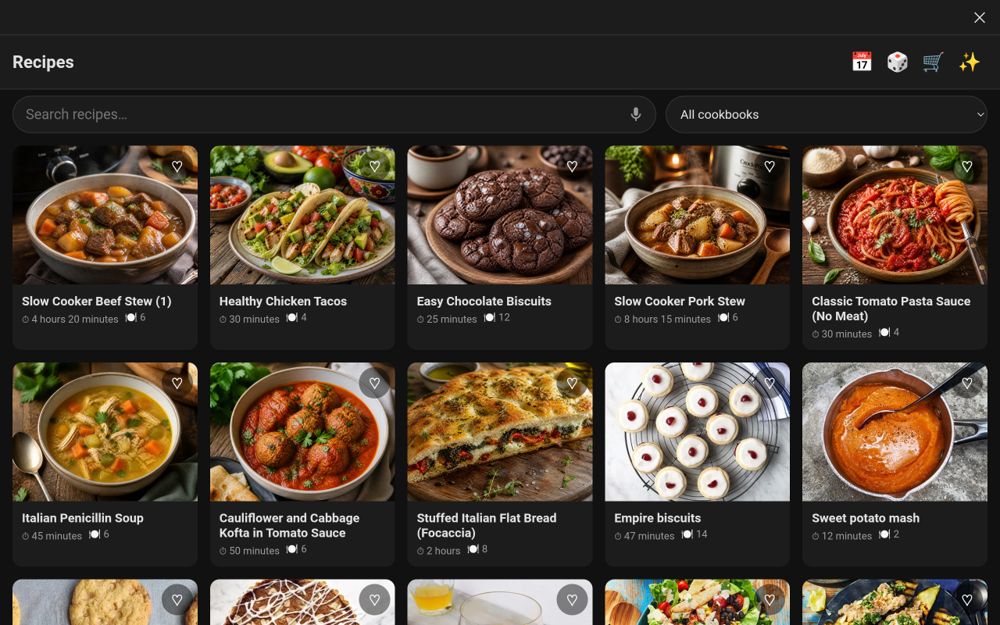</a>
</p>

<p align="center">
  <a href="docs/images/02-cookbook-filter.png">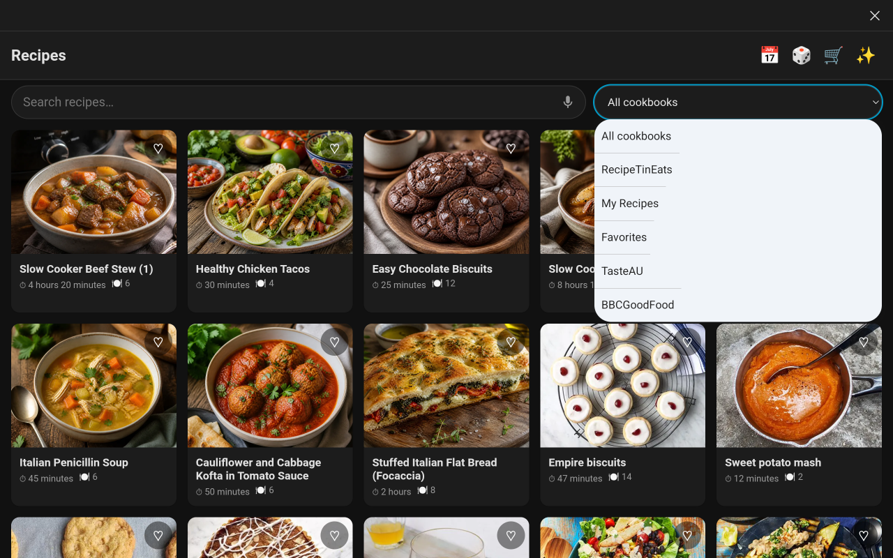</a>
  <a href="docs/images/03-search-with-ai-suggestion.png">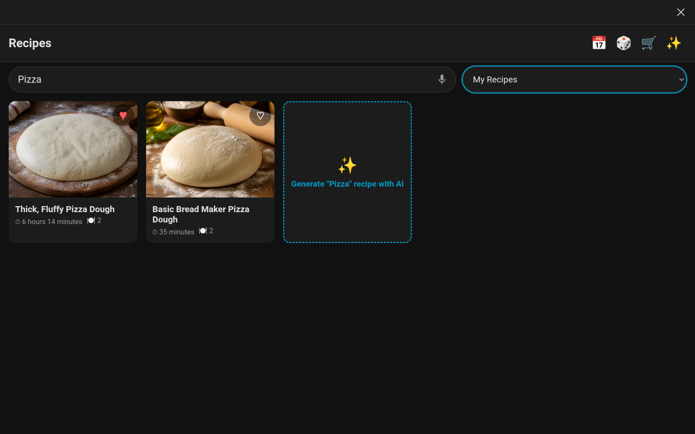</a>
  <br/>
  <a href="docs/images/04-recipe-detail.png">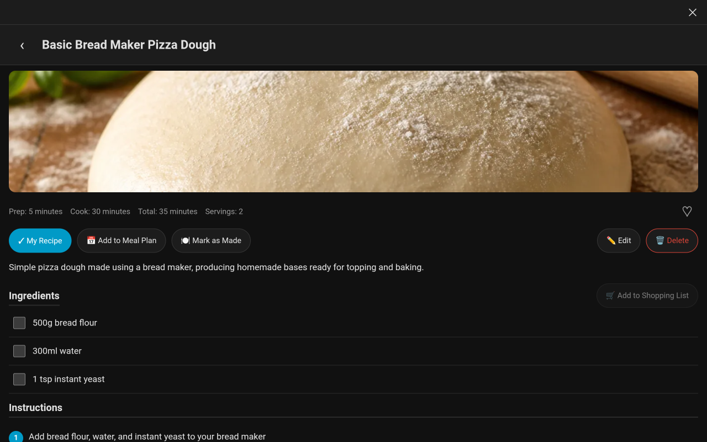</a>
  <a href="docs/images/05-cooking-mode.png">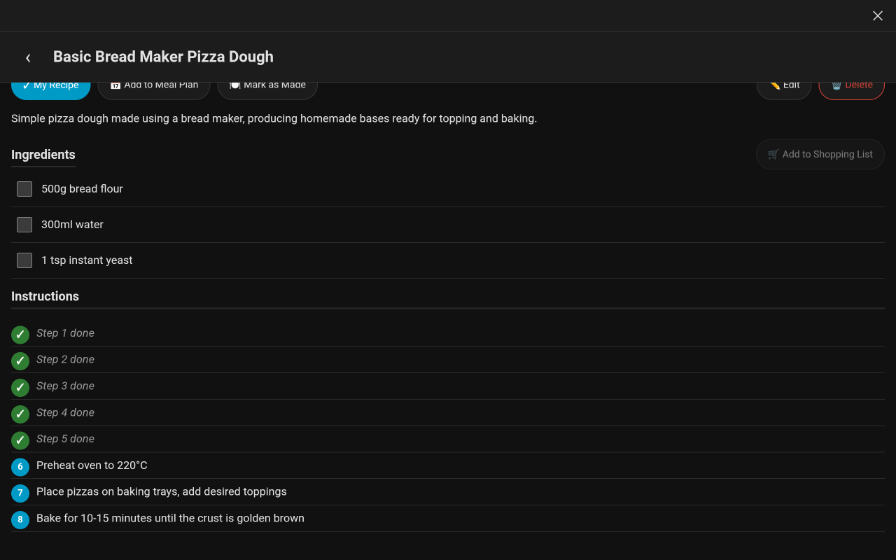</a>
  <br/>
  <a href="docs/images/06-recipe-editor.png">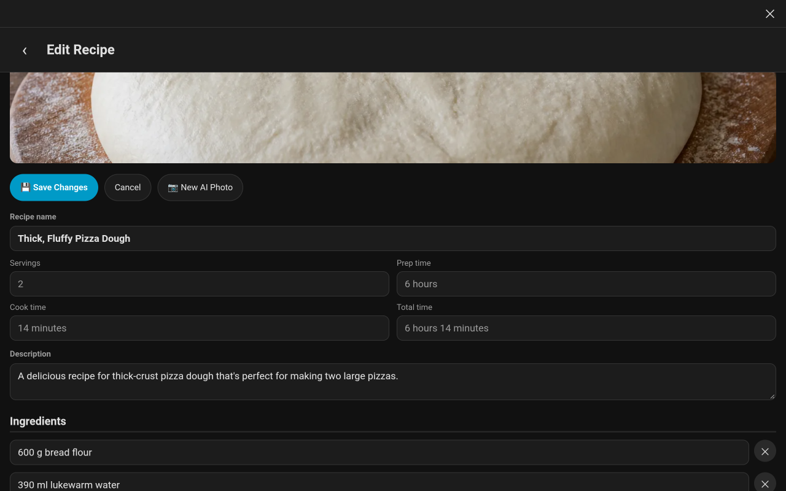</a>
  <a href="docs/images/07-ai-generate-prompt.png">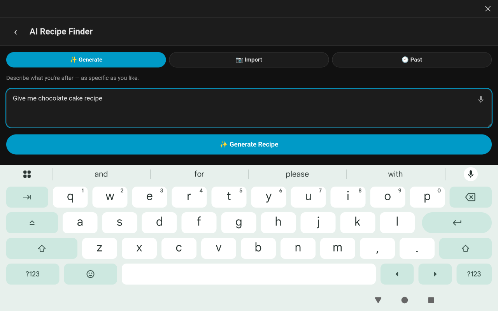</a>
  <br/>
  <a href="docs/images/08-ai-generated-recipe.png">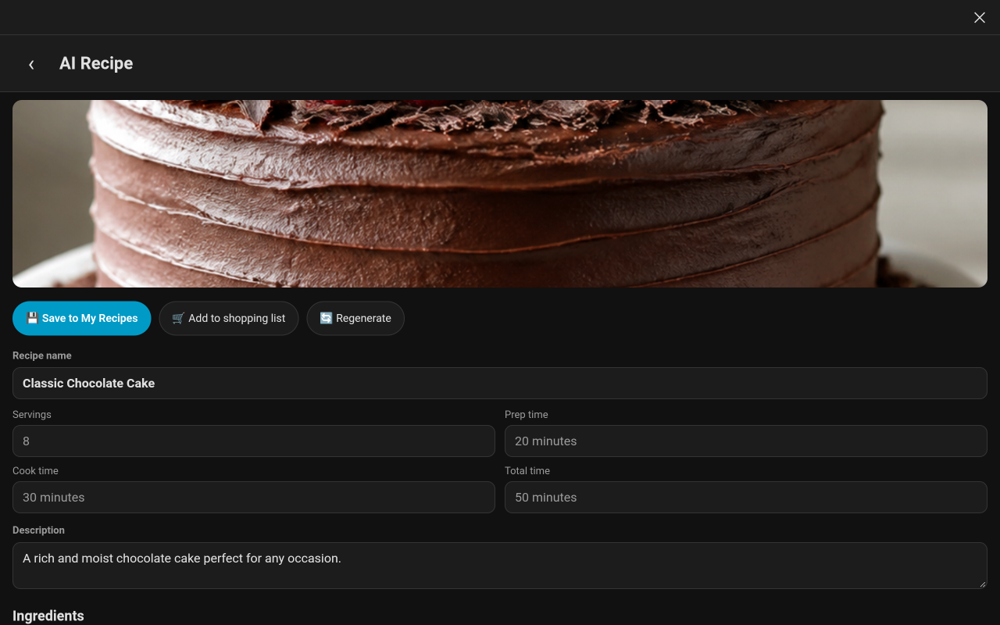</a>
  <a href="docs/images/09-ai-import-from-photo.png">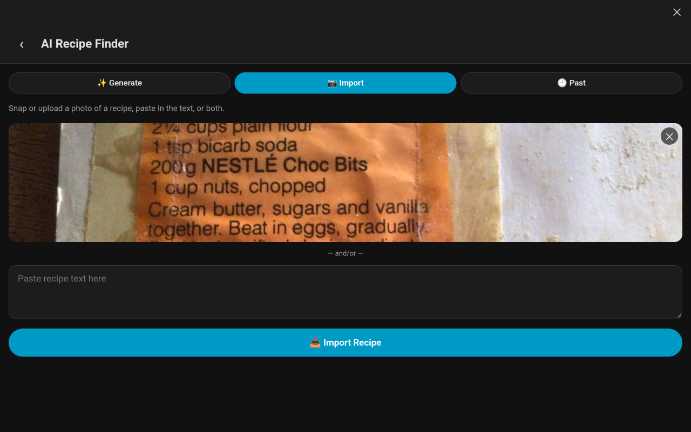</a>
  <br/>
  <a href="docs/images/10-ai-import-from-text.png">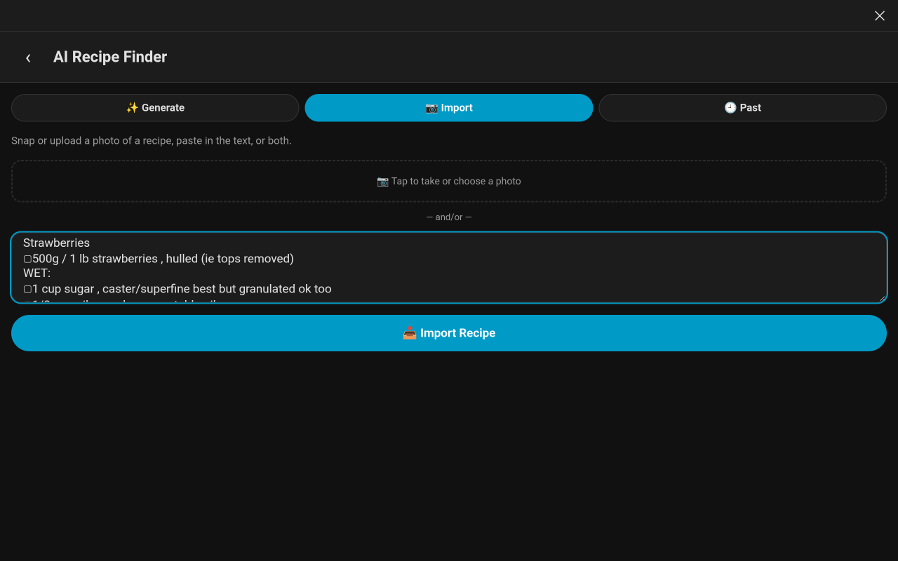</a>
  <a href="docs/images/11-ai-imported-recipe.png">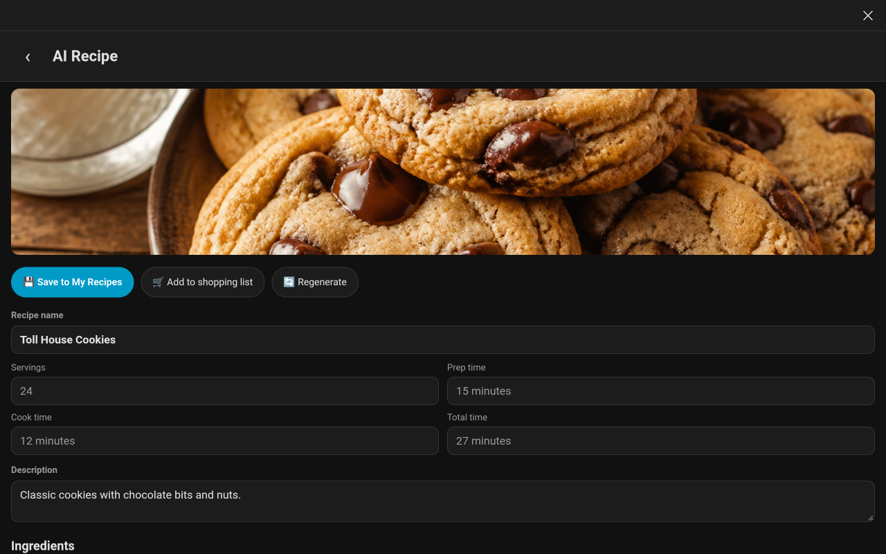</a>
  <br/>
  <a href="docs/images/12-meal-plan.png">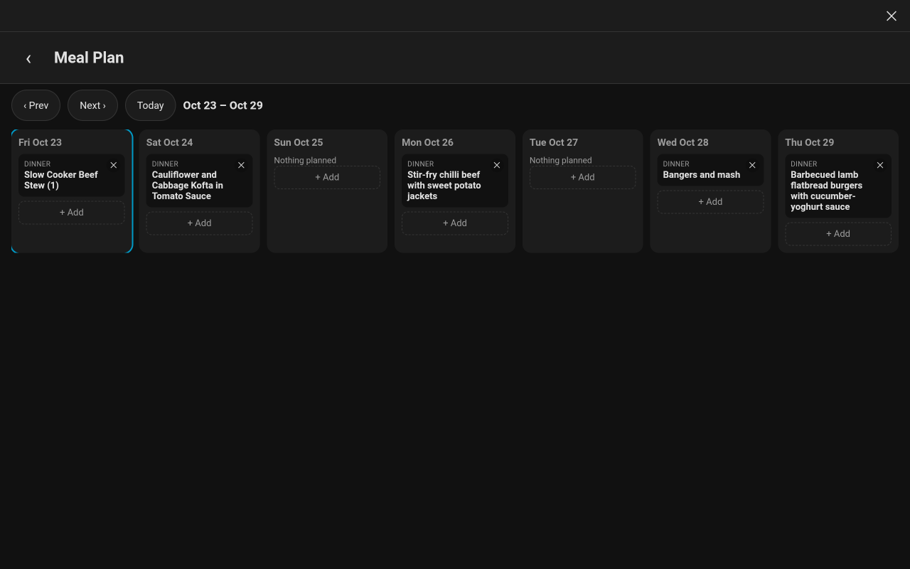</a>
  <a href="docs/images/13-surprise-me.png">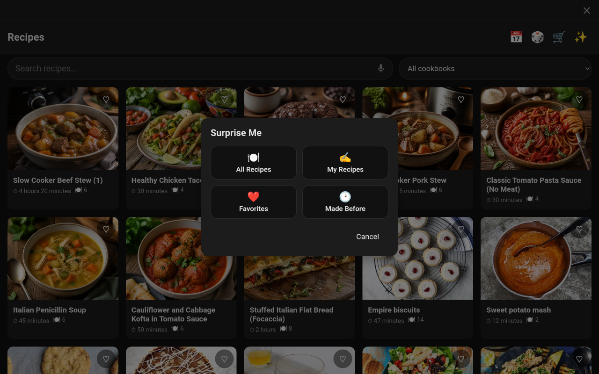</a>
</p>

<p align="center">
  <a href="docs/images/14-dashboard-cards.png">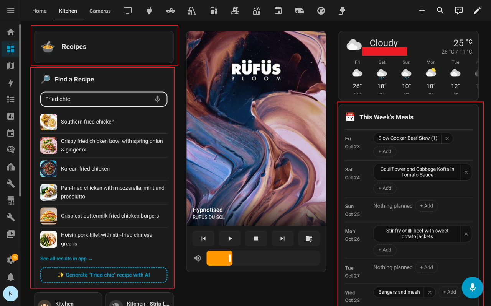</a>
</p>

## Features

- Browse and search recipes, with a cookbook filter
- Full recipe detail view: ingredients (with a shopping-list-style checklist), and a step-by-step "cooking mode" that ticks off each instruction as you go
- Favorite recipes (syncs with Mealie's own native favorites) and a "My Recipe" tag, each with an auto-created cookbook so they're easy to browse back to
- Add a recipe to Mealie's meal plan (date + meal type), and a rolling 7-day view of your plan starting today
- Add a **freeform meal plan entry** with no recipe attached (e.g. "Leftovers", "Eating out"), and remove any entry — recipe-linked or freeform — with confirmation
- Mark a recipe as made, recording the date in Mealie
- Add selected ingredients to a Mealie shopping list (or create a new one), plus a dedicated shopping list view with checkable items and list deletion
- "Surprise me" random recipe picker — all recipes, your recipes, favorites, or something you've made before
- Delete a recipe, with confirmation
- A matching Lovelace launcher card, so the panel can also be opened from any dashboard
- **A configurable dashboard card** with its own visual editor — meal plan, random recipes, a "surprise me" picker, the AI recipe generator, or recipe search, each launching straight into the full panel — see [Dashboard Card](#dashboard-card) below
- **AI recipe finder**: generate a recipe from a text description, or import one from a photo and/or pasted text, using your own Home Assistant `ai_task.*` entities. Past AI recipes are kept automatically so you can save the keepers later — see [AI Recipe Finder](#ai-recipe-finder) below
- **Voice input** (optional): a microphone button in the recipe search box, the AI prompt and the dashboard card, transcribing speech with a speech-to-text engine you've already configured in Home Assistant — see [Voice Input](#voice-input) below
- **Ask a voice assistant for a recipe** (optional): say "show me a recipe for fried chicken" and the recipes open on the device you asked from — a tablet, a browser, or the companion app on your phone — with requests from screenless satellites routed to a screen in the same room — see [Ask For A Recipe By Voice](#ask-for-a-recipe-by-voice) below
- All AI features can be switched off and removed from the interface entirely, for anyone who doesn't want them

## Installation

### Via HACS (custom repository)

1. HACS → the "⋮" menu → **Custom repositories**
2. Add this repository URL, category **Integration**
3. Install **Mealie Kitchen Display**, then restart Home Assistant

### Manual

Copy `custom_components/mealie_recipe_panel/` into your Home Assistant `custom_components/` directory, then restart.

## Configuration

Settings → Devices & Services → **Add Integration** → search **Mealie Kitchen Display**.

You'll need:
- Your Mealie instance URL (e.g. `http://192.168.1.50:9000`)
- An API token (Mealie → user menu → Settings → **API Tokens**)

Once added, a **Recipes** entry appears in the sidebar automatically — no further configuration needed. Two Lovelace cards are also available to add to any dashboard: the **Mealie Recipe Launcher** (opens the full panel) — see [Launcher Card](#launcher-card) below — and the **Mealie Recipe Card** — see [Dashboard Card](#dashboard-card) below.

### Shopping lists and Home Assistant's native `todo` entities

This add-on writes shopping list items directly to Mealie — that part needs nothing else. If you'd also like those lists to show up as Home Assistant `todo.*` entities (for voice assistant, other shopping-list cards, etc.), add Home Assistant's separate **core Mealie integration** (Settings → Devices & Services → Add Integration → search "Mealie") — it mirrors each Mealie shopping list to a `todo` entity, kept in sync in both directions. That's a different, official integration that ships with Home Assistant; this add-on doesn't duplicate that syncing itself.

## Launcher Card

Add **Mealie Recipe Launcher** (`custom:mealie-launcher-card`) to any dashboard — a single button that opens the full recipe panel. Has its own visual editor (Title, Overlay, Panel path), or configure via YAML:

```yaml
type: custom:mealie-launcher-card
title: Recipes
overlay: true
```

| Option | Default | What it does |
|---|---|---|
| `title` | `Recipes` | Label shown on the card. |
| `panel_path` | `/mealie-recipes` | Only needed if the panel's been registered under a non-default URL. |
| `overlay` | `false` | When `true`, opens the panel as a full-screen overlay on top of the current dashboard instead of navigating to it — a close button (✕) returns to exactly where it was launched from, with no navigation history entry added. When `false` (default), opening the panel navigates to it like any other page. |

## Dashboard Card

Add **Mealie Recipe Card** (`custom:mealie-dashboard-card`) to any dashboard — it has its own visual editor (mode dropdown, title, and mode-specific options), so YAML isn't required. Each card instance shows one mode:

| Mode | What it shows |
|---|---|
| `mealplan` | A rolling meal-plan window starting today. Options: **Number of days** (1–14, default 7), **Show recipe thumbnails** (photo tiles instead of text chips). Includes the same "+ Add" freeform entry and "✕" remove-with-confirm affordances as the full panel. |
| `random` | A shuffleable grid of random recipes. Options: **Number of recipes**, **Recipe pool** (all / your recipes / favorites / made before). |
| `random-finder` | A "🎲 Surprise Me" button with a pool selector — one pick at a time, with a "Try Again" reroll. |
| `ai-generate` | A prompt box; submitting launches the full panel with that prompt prefilled and generation already underway. Shows the same "needs configuring" / "disabled" messaging as the panel if AI isn't set up. |
| `search` | Live recipe search, with an AI "Generate '\<query\>' recipe with AI" card and a "See all results in app" link. |

Selecting a recipe from any mode (a meal-plan entry, a random tile, a search result) opens the full panel straight to that recipe. Every mode also accepts an **Overlay** option (opens full-screen on top of the current dashboard instead of navigating away — same as the [launcher card's](#launcher-card) overlay mode) and a **Panel path** option, only needed if the panel's been registered under a non-default URL.

## AI Recipe Finder

Tap the ✨ button on the recipe list to open the AI Recipe Finder. It has three tabs:

- **Generate** — describe what you want ("a thick and crispy pizza dough"), and an LLM writes a full recipe.
- **Import** — take/upload a photo of a recipe (a cookbook page, a handwritten card, a screenshot) and/or paste in recipe text, and an LLM transcribes it into the same structured format.
- **Past** — every recipe you've generated or imported, kept automatically (the last 20) so you can come back to one after cooking it. Past recipes are stored in Home Assistant, not Mealie, until you choose **Save to My Recipes**; you can also add one's ingredients to a shopping list without saving it.

Either way you land on an editable preview — every field, including the name, can be changed, ingredients and instructions can be added/removed, and steps can be dragged into a new order — before you save it to My Recipes in Mealie. Optionally, a second AI model generates a photo for the recipe at the same time.

This feature is **off by default** and needs no LLM provider bundled with it — it works entirely through Home Assistant's own [`ai_task`](https://www.home-assistant.io/integrations/ai_task/) platform, so it uses whatever AI integration(s) you've already set up in Home Assistant (OpenAI, Anthropic Claude, Google Generative AI, a local Ollama server, etc).

### Configuring it

1. Set up at least one AI integration in Home Assistant first (Settings → Devices & Services → Add Integration → e.g. "OpenAI Conversation", "Anthropic Claude", "Ollama") and make sure it has created an `ai_task.*` entity for it. Some integrations create this automatically; others need it added explicitly as a subentry (e.g. an "AI Task" entry under OpenAI Conversation).
2. Settings → Devices & Services → **Mealie Kitchen Display** → **Configure**.
3. Pick an **AI Task entity for recipe text** — this powers both the Generate and Import tabs. Any entity that supports `ai_task`'s `GENERATE_DATA` feature works; for photo import specifically, it also needs `SUPPORT_ATTACHMENTS` (most current multimodal providers have this — text-only models won't).
4. Optionally pick an **AI Task entity for recipe images** — this needs `ai_task`'s `GENERATE_IMAGE` feature, which far fewer providers implement (see below). Leave it unset to skip photo generation; recipes still save fine without a photo.

Both are optional and independent — you can use one provider for text and a different one (or none) for images.

### Supported / tested models

This feature is provider-agnostic by design (it only talks to Home Assistant's `ai_task` API, never to an LLM directly), so anything Home Assistant itself exposes as an `ai_task` entity should work. Tested during development:

| Use | Provider | Notes |
|---|---|---|
| Recipe text (Generate + Import) | OpenAI (e.g. `gpt-5`), Anthropic Claude | Both worked well out of the box, including photo import (attachments). |
| Recipe text (Generate + Import) | Local Ollama models | Works for text; attachment/vision support depends on the specific model pulled. |
| Recipe images | OpenAI `gpt-image-2` (and the `gpt-image-1`/`1.5` family) | Works, but see **OpenAI organization verification** below — this is required, not optional. |
| Recipe images | Local Ollama models | **Not currently possible.** Home Assistant's official Ollama integration does not implement `ai_task`'s image-generation feature for any model, even an image-generation model you've pulled locally (confirmed from HA core source, as of Aug 2026). Picking an Ollama entity as the image entity will fail every time with "does not support generating images". |

If you use a provider not listed here, the same two feature flags decide what works: `GENERATE_DATA` (+ `SUPPORT_ATTACHMENTS` for photo import) for the text entity, `GENERATE_IMAGE` for the image entity. If image generation isn't available for your preferred provider, the rest of the feature still works fine without it.

### OpenAI organization verification

If you use OpenAI for recipe photos, you'll likely hit this error the first time: `does not exist` or `Error talking to OpenAI` with a 403. As of 2026, every current OpenAI image model (`gpt-image-1`, `gpt-image-1-mini`, `gpt-image-1.5`, `gpt-image-2`) requires **organization verification** — a one-time identity/business check, separate from billing — before the API will generate images at all. (DALL-E, which didn't require this, was fully retired by OpenAI in 2026, so there's no unverified fallback within OpenAI.)

To fix: go to [platform.openai.com/settings/organization/general](https://platform.openai.com/settings/organization/general) and click **Verify Organization**. It can take up to 15 minutes to propagate after verifying. Also double-check the model field in your OpenAI Conversation entry — it must be the exact API model id (e.g. `gpt-image-2`), not a display name like "GPT Image 2".

If you'd rather not verify with OpenAI, a local Ollama image-generation model is a free alternative for the *text/import* side of this feature, but — per the table above — can't currently be used for the image-generation side; that part is OpenAI-only for now.

## Voice Input

Typing on a kitchen tablet with floury hands is no fun, so the add-on's short free-text boxes can be dictated instead. A 🎤 button appears inside:

- the recipe search box in the panel,
- the AI Recipe Finder's **Generate** prompt,
- the dashboard card's **search** and **ai-generate** boxes.

Tap it and talk. The icon turns your theme's accent colour and a halo tracks your voice, so you can see it's hearing you; Home Assistant's own voice-activity detection ends the recording when you stop speaking, so there's nothing to release. Tapping again while it's listening cancels and discards the audio. A dictated search runs immediately; a dictated AI prompt only fills the box, so a misheard phrase can't spend an AI call on its own. Trailing punctuation is stripped, since speech engines tend to end a phrase with a full stop.

Recipe *editing* is deliberately left typing-only — this is for short, throwaway text, not for dictating a whole recipe.

Like the AI features, this bundles no speech provider of its own. It runs Home Assistant's [Assist pipeline](https://www.home-assistant.io/voice_control/) with both the start and end stage set to speech-to-text, so **only** the speech stage executes — no conversation agent is invoked and no text-to-speech is produced. Audio streams over the page's existing authenticated Home Assistant connection; nothing is sent anywhere else.

### Configuring it

1. Make sure you have a working Assist pipeline with a speech-to-text engine (Settings → Voice assistants).
2. Settings → Devices & Services → **Mealie Kitchen Display** → **Configure**.
3. Turn on **Enable voice input (speech to text)**.
4. Optionally pick an **Assist pipeline for voice input**. Leave it empty to use whichever pipeline Home Assistant has marked as preferred.

Voice input is **off by default**, because it needs microphone permission on the device.

### Things worth knowing

- **Pick a general-purpose engine.** Whisper-based engines (e.g. the Faster Whisper add-on) and cloud engines transcribe free-form speech, which is what recipe names need. **Speech-to-Phrase only recognises pre-defined phrases** and will return nonsense for "chicken and chorizo paella" — don't choose a pipeline that uses it.
- **Microphone access needs a secure context.** Over HTTPS (or `localhost`) browsers are fine. The Home Assistant companion app and kiosk browsers such as Fully Kiosk each need microphone permission granted to the app itself in your device's settings; without it the button reports that access was blocked.
- The button hides itself entirely when voice input is switched off, when the page isn't a secure context, or when the device has no microphone — so you never get a mic button that can't work.

## Ask For A Recipe By Voice

Ask for a recipe out loud and it appears **on the device you asked from** — a tablet running [kiosk-satellite](https://github.com/jxlarrea/kiosk-satellite) or the [voice satellite card](https://github.com/jxlarrea/voice-satellite-card-integration), Fully Kiosk, a browser, or Assist inside the Home Assistant companion app on a phone or tablet:

> "Show me a recipe for fried chicken"
> "Show me my favourite pizza dough recipe"
> "Give me a pizza dough recipe from Taste"

The assistant answers with what it's showing ("Showing pizza dough recipes from TasteAU"), the search results open over whatever the screen was displaying, and closing them returns it to exactly where it was.

### How the request is understood

There are no sentence templates to learn or maintain. The add-on registers a `MealieShowRecipe` intent and exposes it to Home Assistant's [LLM tool API](https://www.home-assistant.io/integrations/conversation/) — so any assistant whose conversation agent has the **Assist** LLM API enabled (OpenAI, Anthropic Claude, Ollama, …) can call it, and the model works out the phrasing. The tool is described to the model with **your own cookbook names included**, which is what lets a half-remembered name land on the right collection:

| What you say | Where it searches |
|---|---|
| "my favourite pizza dough", "a favourite…" | your **Favorites** cookbook |
| "my pizza dough", "mine", "my own", "my saved" | your **My Recipes** cookbook |
| "…from Taste", "…from recipe tin", "…from bbc" | the closest-matching cookbook by name |
| "a pizza dough recipe", "show me pizza dough" | everything |

Cookbook names are matched generously — exactly, then by containment ("taste" → "TasteAU"), then by closest spelling — so a mangled transcription usually still lands. If a named cookbook can't be matched at all, it searches everything and says so rather than failing. If nothing matches the dish, it says that too instead of opening an empty screen.

### Configuring it

1. Make sure the assistant your satellite uses has an LLM conversation agent with the **Assist** API enabled (Settings → Devices & Services → your AI integration → the conversation entry → *Control Home Assistant*). The built-in non-LLM agent can't call tools, so this feature needs an LLM-backed pipeline.
2. Settings → Devices & Services → **Mealie Kitchen Display** → **Configure**.
3. Turn on **Let voice assistants show recipes on the asking device**. There's no per-device setup: asking a device and getting the answer back on it needs no permission list.

### Which screen it opens on

Recipes go to the device that asked, by whichever route suits it:

| You asked from | What happens |
|---|---|
| A browser-based voice satellite (kiosk-satellite, the voice satellite card, Fully Kiosk, a desktop browser) | The results open as an overlay over whatever that screen was showing; closing them returns it to exactly where it was. |
| Assist in the companion app, on the device you're holding | The app opens straight to the results (Android `command_webview`; it needs the app's "display over other apps" permission, which Android asks for the first time). |
| Any other companion-app device | A notification arrives — "*pizza dough* — tap to open" — which opens the results. Works on Android and iOS. |
| An assistant that can't show a web page — a speaker, or an ESPHome, Wyoming or VoIP satellite | A screen **in the same area** is used, so the lounge satellites answer on the lounge tablet and the kitchen ones on the kitchen tablet. The assistant says where it went. |
| Nothing suitable in that room | The **fallback screen** from the options, if you've set one; otherwise the assistant says it has nowhere to show them. |

Note that a satellite having a display isn't the same as it being able to show recipes: an ESPHome panel (an ESP32-P4 wall panel, say) draws its own interface and has no browser, so it's treated as screenless and routed by area.

Browser screens running a voice satellite identify themselves automatically. To make a browser that *isn't* running one answer a particular satellite's requests, visit this once on that screen:

```
/mealie-recipes?voice_screen=assist_satellite.kitchen_tablet
```

Visiting `/mealie-recipes?voice_screen=` (empty) clears it again.

Two things worth knowing: delivery is fire-and-forget, so if a screen is off or isn't showing Home Assistant the assistant will still say it's showing recipes; and a browser screen in a background tab deliberately ignores requests so it can't swallow one meant for the tablet in front of you.

## Development

Frontend source (Lit + TypeScript) lives in `frontend/`. To rebuild after making changes:

```bash
cd frontend
npm install
npm run build
cp dist/*.js ../custom_components/mealie_recipe_panel/www/
```

Restart Home Assistant to pick up backend (`custom_components/mealie_recipe_panel/*.py`) changes; frontend changes take effect on a normal browser refresh (the served JS is cache-busted with a content hash per restart).

## License

MIT — see [LICENSE](LICENSE).
